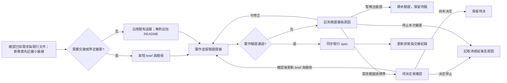

# 專案 change 工作流程（按需試用）

這是供新專案自行評估的初版指南，不是所有專案的預設規則。先沿用專案既有的 spec、issue 與驗收方式；只有當變更需要跨對話說清楚範圍、交接或追溯決定時，才採用下列做法。它是手寫的工作參考，不由本 repo 的 generator 產出，也不要求安裝工具。

## 何時寫 change brief

既有行為或驗收標準要改、已有 spec 卻缺少這次需協調的行為定義、範圍有重要取捨，或工作將跨 agent／對話交接時，先寫一份短 brief。記錄原因、目標行為、範圍與不做的事、可觀察的驗收條件、受影響的現行 spec、未決問題及回復方式。全新專案的首個行為可先用下方的最小文件起步；小型文件修正、機械性修改，若既有 issue／PR 已能完整承載資訊，也可不另建 brief。不要為了湊流程建立空檔。

| 載體 | 負責的資訊 |
|---|---|
| 現行 spec | 已確認、仍適用的產品／技術行為；變更完成後在原條文更新，避免第二份「現行真相」。 |
| Change brief | 這一次為何改、改什麼、如何驗收，以及當時尚未確定或尚未完成的部分；它是有日期的變更紀錄。 |
| 任務狀態 | 誰在做、目前卡在哪、下一步與決定者；優先用既有 issue 或追蹤系統，尚無時記在一份最小文件。交接快照不代表即時狀態。 |
| 驗收證據 | 測試結果、實際畫面／操作、review 決定與未驗證項；記在採用的追蹤紀錄或連到證據位置，寫清執行環境與時間。 |

`plan.md` 只在技術選擇、依賴或分階段方案需要獨立審查時新增；`tasks.md` 只在多步驟工作需要持續勾稽、跨人分工或中斷續做時新增。簡單變更直接用 brief 加既有 issue／PR 即可。

全新專案若還沒有 spec 或 issue，不必先建立整套文件與追蹤系統。在 README 或一份短文件記下已確定的目標、首個可驗收行為、驗收方式、目前狀態與下一步；需要 brief 時，將本次狀態、下一步與證據移到 brief，避免兩處維護進度。行為通過驗收後，將仍適用的內容整理到 README 或現行 spec，brief 留作歷史紀錄；待工作並行或交接需求增加，再採用獨立 issue。

## 執行、交接與收尾

1. 開始前核對已知需求、程式、現行 spec 與任務狀態；新專案沒有的文件不必假設存在。有衝突就標出觀察、假設與待決定項。實作時讓變更與採用的追蹤紀錄能互相定位，依專案實際驗證方式留結果及未驗證項。
2. 交給另一個 agent 時，寫下交接**當時**的日期時間與時區、branch、完整 commit SHA、工作樹是否有未提交修改，以及已做／未做、驗證結果、阻塞點和下一步。若沒有 commit，明說 SHA 只代表當時的 HEAD，未提交差異另列。接手者先重查最新 issue／PR、branch HEAD、工作樹及現行 spec，再把它們與 brief／交接快照比對；舊紀錄只證明當時狀態，不自動代表現在。
3. 驗收未通過時，先留下失敗證據與原因：可在原標準下修正就修正後重驗；環境或證據不足就標「未驗證」，保留待驗，不記完成；若需改目標、範圍或標準，停在待決，由有權決定的人確認並更新 brief／驗收條件後再執行；若決定停止，記取消或延後及原因。**Agent 不得自行放寬原條件，也不得把部分通過寫成完成。**
4. 行為確定且驗證通過後，在原現行 spec 或新專案的最小基線同步實際行為，檢查與 code、brief 的差異；尚未完成的目標不要寫成已上線。收尾時連回採用的追蹤紀錄、提交驗收證據，更新狀態與剩餘風險。

## Portfolio 有限試跑

- [EVA-18](https://linear.app/evanccw/issue/EVA-18/讓鍵盤焦點展開-work-card-摘要) 與 [EVA-19](https://linear.app/evanccw/issue/EVA-19/mobile-nav-按-escape-關閉) 的 brief、spec、code、issue 可互相定位，成果收在 [PR #1](https://github.com/evanwu-tw/Portfolio-website/pull/1)。EVA-18 由 Codex 執行，Claude 冷讀後接手並主導 EVA-19；[EVA-17 試跑紀錄](https://linear.app/evanccw/issue/EVA-17/試跑-portfolio-文件路由與-changes-brief-架構)回報冷讀補問 0 次、EVA-19 返工 0 次，但早期未提交的多 issue diff 曾混在同一工作樹。
- [EVA-23](https://linear.app/evanccw/issue/EVA-23/加入-skip-to-content-連結讓鍵盤跳過導覽) 由 Claude 先寫 brief 並交接，Codex 冷讀後實作，留下 commit 與 [PR #2](https://github.com/evanwu-tw/Portfolio-website/pull/2)。接手時發現 brief 底部的 branch／HEAD 已過期，靠最新 issue 紀錄、Git 與 PR 辨認現況。Evan 已確認手機與桌機樣式；PR #2 於 2026-11-03 合併至 `main`（[merge commit](https://github.com/evanwu-tw/Portfolio-website/commit/e0e7640dc17d46a4b3b1cafd4db057b8f3820177)），issue 為 Done。先前 2026-10-30 的 `mergeStatus: blocked` 是過期或不準確的訊號，具體成因未確認；部署狀態未驗證。

這些紀錄支持「在三次小型行為變更中可交接、可追溯」，不支持「長期文件維護成本已下降」。樣本少、類型接近；低補問也可能來自變更範圍小或執行者已熟悉專案。下一個專案應記錄每次找資料、寫／同步文件、補問與返工所花時間，並檢查較複雜的變更中，舊快照或多 issue 工作樹是否再次造成誤判。

## 與 OpenSpec、Spec Kit 的關係

可借用「逐次變更留紀錄、驗收後同步現行 spec」的概念。[OpenSpec 官方 quickstart](https://openspec.dev/docs/quickstart)描述 change folder 內的 proposal、specs、按需的 design 與 tasks，完成後 archive 會更新主要 specs。[Spec Kit 官方 Agentic SDD 參考](https://github.github.com/spec-kit/reference/agentic-sdd.html)則提供 specify、plan、tasks、implement 等命令及可選的品質檢查。這份指南只抽取適合本地文件分工的概念；Portfolio 試跑沒有安裝、執行或驗證兩套 CLI，也沒有驗證它們的完整流程或整合。
